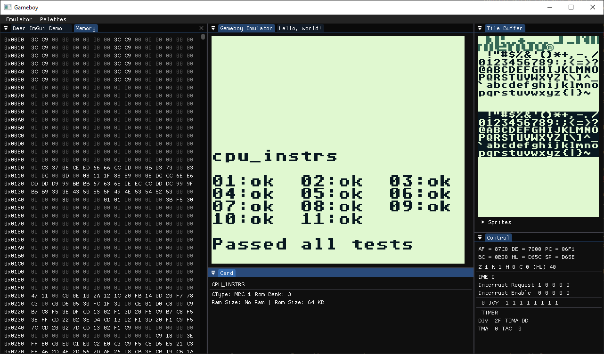

# C++ Gameboy Emulator

Ein Gameboy Emulator mit vollständig implementierter CPU.

Dieses Projekt wurde von mir entwickelt, um C++ zu lernen, mich  mit der C++-Toolchain vertraut zu machen und praktische Erfahrungen im Umgang mit verschiedenen Bibliotheken zu sammeln.

## Demo

<video src="screenshots/demo.mp4" width="40%" controls autoplay loop muted>
  Dein Browser unterstützt das Video-Tag nicht.
</video>

## Features

- Alle CPU-Instruktionstests bestanden (Blargg's Tests)
- Die gängigsten Cartridge-Typen (MBC1, MBC3, MBC5) implementiert
- Spiele sind vollständig durchspielbar
