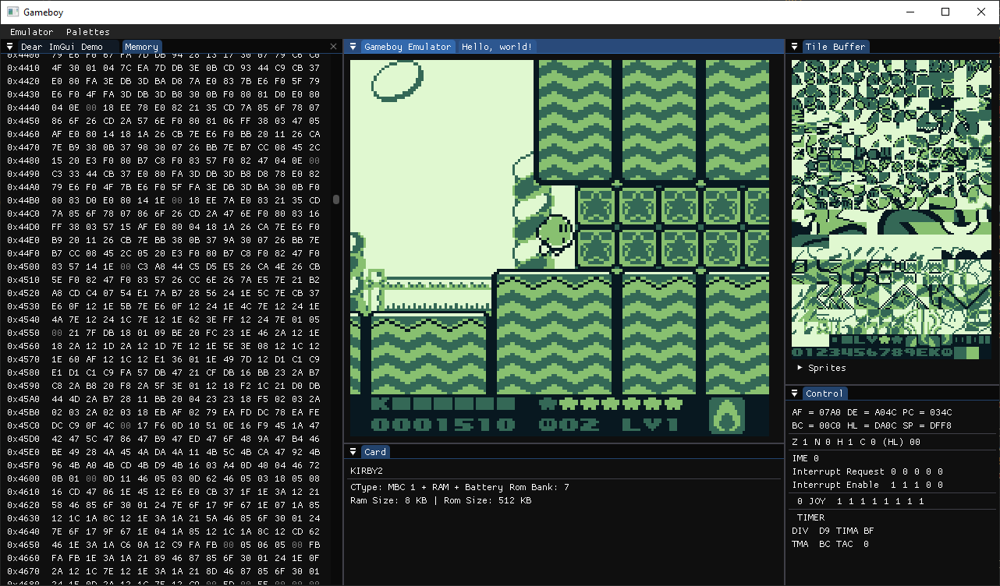
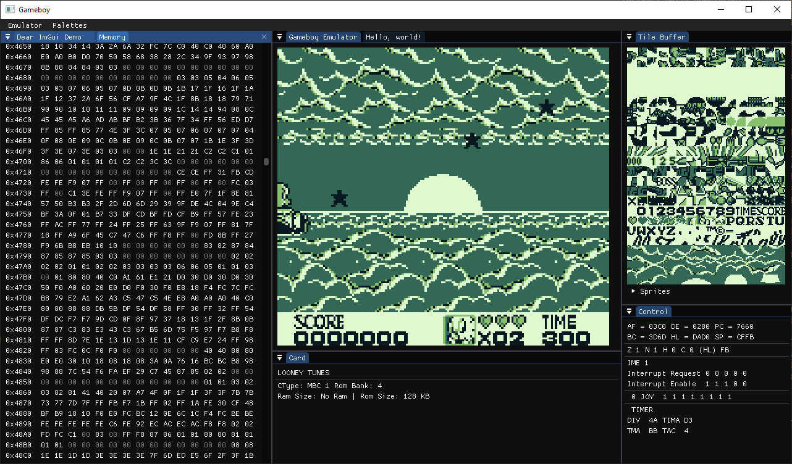
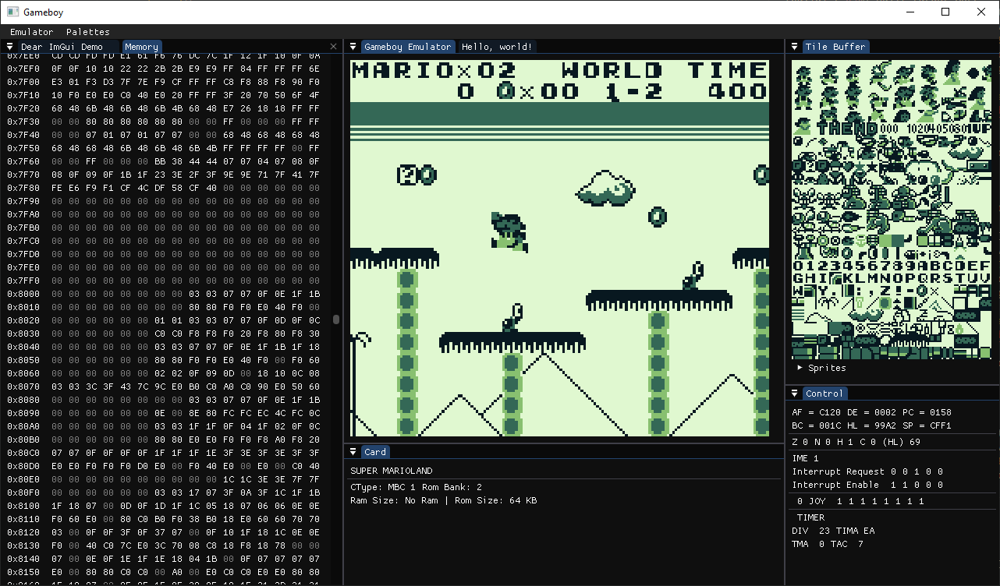

# C++ Gameboy Emulator

Ein Gameboy Emulator mit vollständig implementierter CPU.

Dieses Projekt wurde von mir entwickelt, um C++ zu lernen, mich  mit der C++-Toolchain vertraut zu machen und praktische Erfahrungen im Umgang mit verschiedenen Bibliotheken zu sammeln.

## Demo


<video src="screenshots/demo.mp4" width="40%" controls autoplay loop muted>
  Dein Browser unterstützt das Video-Tag nicht.
</video>






## Features

- Alle CPU-Instruktionstests bestanden (Blargg's Tests)
- Die gängigsten Cartridge-Typen (MBC1, MBC3, MBC5) implementiert
- Spiele sind vollständig durchspielbar

## Build

Alles wird statisch gelinkt (SDL3, ImGui, spdlog); die exe braucht keine eigenen DLLs.

```sh
cmake -S . -B build -G Ninja -DCMAKE_BUILD_TYPE=Release
cmake --build build --target cpp-gb
```

Tests (Blargg's ROMs separat besorgen, z. B. https://github.com/retrio/gb-test-roms):

```sh
cmake -S . -B build -DCPP_GB_BUILD_TESTS=ON -DGB_TEST_ROMS_DIR=/pfad/zu/gb-test-roms
cmake --build build --target gb_test && ./build/bin/gb_test
```

Logging: spdlog (Konsole, `logs/everything.log`, `logs/error.log`).

Code-Konventionen: Header heissen `.hpp`, Membervariablen enden auf `_`, Funktionen verwenden Trailing Return Types, Formatierung per `.clang-format`.
